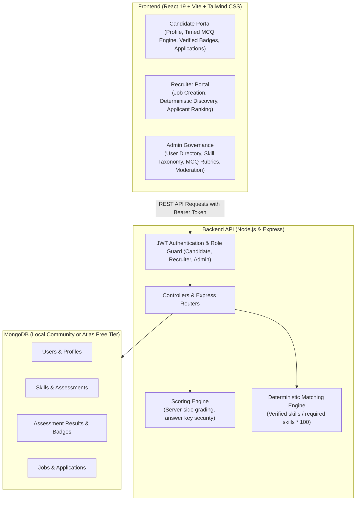

# VeriHire – Skill-Based Recruitment Platform

> **A Complete MERN Stack College Mini-Project**  
> *Reduces Resume Fraud & Helps Companies Identify Authentic Engineering Talent Through Server-Evaluated Technical Assessments, Verified Skill Badges, and Project Portfolios.*

[]()
[]()
[]()

---

## 1. Problem Identification & Innovation

### The Problem
Traditional recruitment platforms rely heavily on unverified self-reported resumes. This causes severe recruitment inefficiency:
- **Resume Fraud & Keyword Stuffing:** Up to 70% of candidate resumes contain inflated skill claims or buzzwords added purely to bypass keyword-matching Applicant Tracking Systems (ATS).
- **Recruiter Fatigue:** Recruiters spend hundreds of hours manually screening unqualified applicants.
- **Inauthentic Portfolios:** Candidates copy project templates without understanding underlying architecture.

### The VeriHire Solution
VeriHire transforms recruitment from **unverified claims** to **proven competencies**:
1. **Server-Side Timed Assessments:** Candidates take timed technical evaluations. Correct answers (`correctIndex`) are strictly stored server-side and never exposed to the browser.
2. **Tamper-Proof Skill Badges:** Scoring $\ge 70\%$ automatically credits a permanent verified badge to the candidate's profile.
3. **Deterministic Match Percentage:** Recruiter search and job applications compute real match scores using the exact mathematical formula:
   $$\text{Matching Score} = \left(\frac{\text{Count of Matched Verified Skills}}{\text{Count of Required Job Skills}}\right) \times 100\%$$
4. **Verified Evidence Portfolios:** Candidates link GitHub source code and live deployments for real-world proof.

---

## 2. System Architecture



---

## 3. Technology Stack (100% Free & Open Source)

| Layer | Technologies | Purpose |
| :--- | :--- | :--- |
| **Frontend** | React 19, Vite, Tailwind CSS v4, Lucide React, React Router v7 | Responsive UI with real-time feedback and clean modern design |
| **Backend** | Node.js, Express.js, JSON Web Tokens (JWT), BcryptJS | RESTful API, authentication, server-side grading, role guards |
| **Database** | MongoDB Community Edition (or MongoDB Atlas Free Tier), Mongoose | Document storage with compound indices for fast candidate search |
| **Testing** | Jest, Supertest | 22 comprehensive integration & security test suites |
| **Security** | Helmet, CORS, Express Rate Limit, Parameter Validation | Hardened headers, brute-force protection, input sanitization |

---

## 4. Database Schema & Models

```
User (Role: candidate | recruiter | admin)
├── CandidateProfile (User ref, headline, summary, education, experienceLevel, skills)
├── RecruiterProfile (User ref, company, companyWebsite, industry, companySize, location)
├── Skill (name, category, description, isActive)
├── Assessment (skill ref, title, duration, passingScore, questions[{ text, options, correctIndex }])
├── AssessmentResult (candidate ref, assessment ref, answers[], score, passed, badgeAwarded)
├── Project (candidate ref, title, description, technologies[], githubUrl, liveUrl, featured)
├── Job (recruiter ref, title, description, requiredSkills[], experienceLevel, jobType, salaryRange)
└── Application (candidate ref, job ref, matchingPercentage, status, coverLetter, recruiterNotes)
```

---

## 5. Prerequisites & Environment Setup

### Required Tools
Make sure the following free tools are installed on your machine:
- **Node.js**: v18.0 or newer (Verified on v24.16.0)
- **npm**: v9.0 or newer
- **MongoDB**: MongoDB Community Server running locally at `mongodb://127.0.0.1:27017` OR a free MongoDB Atlas connection string.

---

## 6. Step-by-Step Installation Instructions

### Step 1: Clone or Navigate to the Project
```bash
cd e:/Download/Antigravity/VeriHire
```

### Step 2: Configure Backend Environment
Navigate to `backend` and create or verify `.env`:
```bash
cd backend
npm install
```

Create `.env` inside `backend/`:
```env
PORT=5000
NODE_ENV=development
MONGO_URI=mongodb://127.0.0.1:27017/verihire
JWT_SECRET=verihire_super_secret_jwt_key_2026_academic_production_grade
JWT_EXPIRE=7d
CLIENT_URL=http://localhost:5173
```

### Step 3: Seed Database with Realistic Demo Data
Run the master database seed script to populate skills, assessments with 5 MCQs each, candidate profiles, verified badges, recruiter profiles, jobs, and applications:
```bash
npm run seed
```

### Step 4: Run Backend Integration Tests
Verify all 22 tests pass:
```bash
npm test
```

### Step 5: Start the Backend Server
```bash
npm run dev
# Server will run at http://localhost:5000
```

### Step 6: Configure and Start Frontend
In a new terminal window:
```bash
cd ../frontend
npm install
```

Verify `.env` inside `frontend/`:
```env
VITE_API_URL=http://localhost:5000/api
```

Start Vite development server:
```bash
npm run dev
# Frontend will be live at http://localhost:5173
```

---

## 7. Demo Credentials & 1-Click Login

The login page at `http://localhost:5173/login` provides **1-click quick-fill buttons** for instant evaluation:

| Role | Email | Password | Pre-seeded Credentials / Badges |
| :--- | :--- | :--- | :--- |
| **Administrator** | `admin@verihire.com` | `Admin@123` | Full platform control: user moderation, assessment rubrics, skill taxonomy |
| **Recruiter** | `recruiter@techcorp.com` | `Recruiter@123` | TechCorp Innovations: 3 active job postings with candidate applicants |
| **Candidate** | `alex@example.com` | `Candidate@123` | High-match candidate: Verified in JavaScript (85%) & React (90%), with full portfolio |
| **Candidate** | `priya@example.com` | `Candidate@123` | Backend candidate: Verified in Node.js (80%) & MongoDB (85%) |

---

## 8. Complete End-to-End Evaluation Flow

To demonstrate the full lifecycle to college evaluators:

1. **Candidate Verification Experience:**
   - Log in as `priya@example.com` (`Candidate@123`).
   - Navigate to **Skill Assessments** (`/candidate/assessments`).
   - Launch an unattempted assessment (e.g. *JavaScript Core Concepts*).
   - Review instructions, timer countdown, and answer the 5 MCQs.
   - Submit assessment: Observe instantaneous server-side score evaluation and immediate badge credit.
   - Inspect **Verified Badges** (`/candidate/skills`) to see the permanent credential.

2. **Project Portfolio Showcase:**
   - Go to **Project Portfolio** (`/candidate/projects`).
   - Add a new full-stack project with GitHub repo, live demo link, and technologies.

3. **Job Browsing with Deterministic Matching:**
   - Go to **Browse Jobs** (`/candidate/jobs`).
   - Notice the dynamic match percentages (e.g. $100\%$, $50\%$) calculated directly from verified badges.
   - Click **Apply Now** with an optional cover note.

4. **Recruiter Review & Decision:**
   - Log in as `recruiter@techcorp.com` (`Recruiter@123`).
   - Go to **Manage Job Postings** (`/recruiter/jobs`).
   - Click **Applicants** on *Senior Full-Stack Engineer*.
   - Notice candidates are ranked deterministically by verified match score.
   - Click **Update Status** to change an applicant from `applied` to `shortlisted` or `selected` with personalized recruiter notes.

5. **Proactive Candidate Discovery:**
   - Go to **Discover Candidates** (`/recruiter/candidates`).
   - Search for required skills: `javascript, react`.
   - Observe how candidate cards compute real-time match scores and highlight server-verified badges.

6. **Admin Platform Governance:**
   - Log in as `admin@verihire.com` (`Admin@123`).
   - View global statistics at `/admin/dashboard`.
   - Manage platform users, create/edit skill taxonomy, and configure assessment MCQs with correct answer keys.

---

## 9. API Reference Table

| Method | Endpoint | Access | Purpose |
| :--- | :--- | :--- | :--- |
| `POST` | `/api/auth/register` | Public | Register new candidate or recruiter (prevents admin registration) |
| `POST` | `/api/auth/login` | Public | Authenticate user & return JWT token |
| `GET` | `/api/auth/me` | Private | Retrieve logged-in session user |
| `GET` | `/api/candidates/profile` | Private (Candidate) | Get candidate profile, skills, and portfolio |
| `PUT` | `/api/candidates/profile` | Private (Candidate) | Update profile details and recalculate completion % |
| `GET` | `/api/assessments` | Private | List available assessments with candidate status |
| `GET` | `/api/assessments/:id` | Private | Fetch assessment questions (`correctIndex` stripped for security) |
| `POST` | `/api/assessments/:id/submit` | Private (Candidate) | Submit answers, calculate score server-side, award badge |
| `GET` | `/api/assessments/results/my` | Private (Candidate) | Get all assessment attempts and verified badges |
| `GET` | `/api/jobs` | Public | Search and browse active job openings |
| `POST` | `/api/jobs` | Private (Recruiter) | Publish new job with required skills criteria |
| `GET` | `/api/jobs/:id/applicants` | Private (Recruiter) | List applicants ranked by verified match percentage |
| `POST` | `/api/applications/:jobId` | Private (Candidate) | Apply to job with auto-attached verified badges |
| `PATCH`| `/api/applications/:id/status`| Private (Recruiter) | Update applicant status (`shortlisted`, `rejected`, etc.) |
| `GET` | `/api/recruiter/candidates` | Private (Recruiter) | Discover candidates filtered by skills and match % |
| `GET` | `/api/admin/dashboard` | Private (Admin) | Platform analytics & user counts |
| `GET/POST`| `/api/admin/skills` | Private (Admin) | CRUD operations on skill taxonomy |
| `GET/POST`| `/api/admin/assessments`| Private (Admin) | Configure assessment rubrics and MCQ answer keys |

---

## 10. Free Deployment Guide

### Database (MongoDB Atlas M0 Sandbox)
1. Sign up for free at [mongodb.com/atlas](https://www.mongodb.com/atlas).
2. Create a free shared cluster (M0 Sandbox - 512MB free forever).
3. Whitelist IP address `0.0.0.0/0` under Network Access.
4. Copy the connection string into `MONGO_URI`.

### Backend (Render Free Tier)
1. Push repository to GitHub.
2. Sign up at [render.com](https://render.com) and create a **New Web Service**.
3. Set Root Directory to `backend`.
4. Build Command: `npm install`
5. Start Command: `node server.js`
6. Add Environment Variables: `MONGO_URI`, `JWT_SECRET`, `NODE_ENV=production`, `CLIENT_URL`.

### Frontend (Vercel Free Tier)
1. Sign up at [vercel.com](https://vercel.com) and import the repository.
2. Set Root Directory to `frontend`.
3. Framework Preset: `Vite`.
4. Build Command: `npm run build`
5. Output Directory: `dist`
6. Add Environment Variable: `VITE_API_URL=https://your-backend.onrender.com/api`.

---

## 11. College Project Evaluation Criteria Alignment

| Evaluation Parameter | Weightage | How VeriHire Satisfies It |
| :--- | :---: | :--- |
| **Problem Identification** | 10 | Identifies resume fraud, keyword manipulation, and recruitment fatigue; proposes verified skill badges. |
| **UI/UX Design** | 20 | Responsive React 19 interface with Tailwind CSS v4, role-based dashboards, interactive assessment timer, celebratory badges, and accessible layouts. |
| **Backend Architecture** | 20 | Express.js REST API with MVC structure, JWT authorization, server-side scoring security, rate limiting, and 22 automated Jest test suites. |
| **Database Design** | 15 | MongoDB with Mongoose ODM: 9 models, compound unique indices (`candidate + job`), cascade integrity, and optimized queries. |
| **Full-Stack Integration** | 15 | Seamless end-to-end workflow: Candidate registers $\rightarrow$ takes timed MCQ $\rightarrow$ earns badge $\rightarrow$ applies to job with deterministic match score $\rightarrow$ recruiter reviews & updates status. |
| **Testing & Quality** | 5 | 22/22 unit and integration tests passing; clean code with zero compilation errors on `vite build`. |
| **Documentation & Deployment**| 5 | Complete README with architecture diagrams, step-by-step setup guide, demo credentials, and free cloud deployment guide. |
| **Total** | **100** | **Comprehensive Full-Stack MERN Project Ready for Viva & Demo** |
